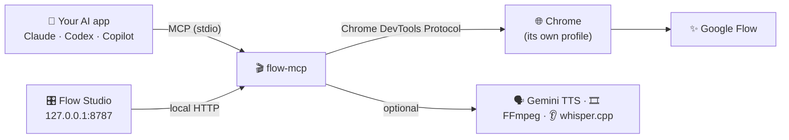

---
hide:
  - navigation
---

# 🎬 flow-mcp

**Make Google Flow videos and images by just asking your AI assistant.**

flow-mcp is a small program that runs on **your** computer. It opens its own Chrome window, uses the Google
account you signed in with, and presses [Google Flow](https://flow.google.com)'s real buttons for you.
Any [MCP](https://modelcontextprotocol.io) app (Claude, Codex, Copilot, Cursor and others) can then make
stills, clips, characters, narration, captions and finished cuts when you ask in plain English.

[🚀 Get started](getting-started.md){ .md-button .md-button--primary }
[🧰 Browse the tools](reference/tools.md){ .md-button }

---

## ✨ What you can make

-   :material-image-multiple: **Free stills, in bulk**

    ---

    Up to 50 storyboard frames at once through Flow's own Agent mode, matched back to your scene order. 0 credits.

-   :material-movie-open: **Clips with a spending cap**

    ---

    Text-to-video, first and last frames, reference images, and chained shots. Flow's own price quote is read
    before each run, and a scene is skipped if it goes over your cap.

-   :material-account-star: **Characters that stay on-model**

    ---

    Create, edit and reuse characters (`asset:Pip`) across every shot.

-   :material-arrow-right-bold-circle: **Seamless continues**

    ---

    Start a new clip on the exact last frame of an earlier one, so the cut doesn't show.

-   :material-microphone: **Narration and captions**

    ---

    Free Google or system voices of any length, plus word-timed captions in about 100 languages. Both run on your computer.

-   :material-content-cut: **A finished cut**

    ---

    Join clips, mix in narration and music, and download everything again for free (including the 1080p upscale).

## 🤔 Why not just use the API?

Google sells Veo through a pay-per-use API. flow-mcp spends the **Flow credits you already have** instead:
every Google account gets 50 a day, and stills cost 0. It drives the real web UI at a human pace, one job at a
time, with nothing hosted anywhere.

## 🍴 About this fork

This is a fork of [GTAI-1/flow-mcp](https://github.com/GTAI-1/flow-mcp), and the original work belongs to its
author. This fork reorganises the docs and keeps building from there. See the
[roadmap](project/roadmap.md) for what's next.

## ⚠️ Disclaimer

flow-mcp automates Flow's web interface. It can break whenever Google changes that interface, and automated
use may be against Google's terms of service. Use it on your own account, at your own risk. It isn't
affiliated with or endorsed by Google.
