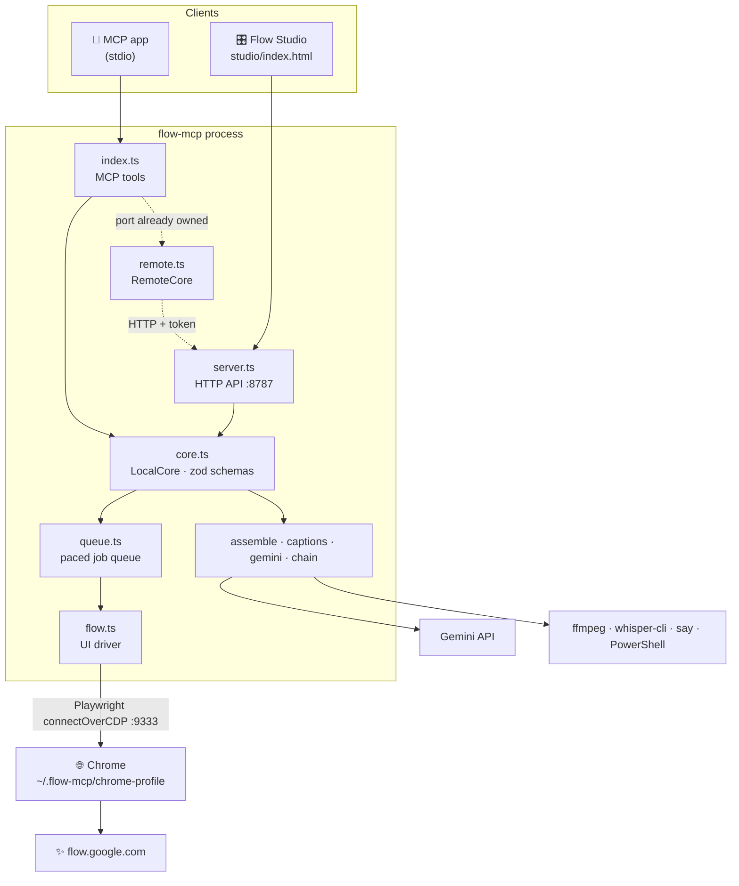

# 🔬 APIs & architecture

This page covers every interface flow-mcp uses or exposes, what it uses each one for, and where the code lives.
The [roadmap](../project/roadmap.md) builds on it to suggest what to add next.

## 1. 🤖 MCP (what flow-mcp exposes)

| Aspect | Today |
|---|---|
| SDK / transport | `@modelcontextprotocol/sdk` ^1.30, `McpServer` + `StdioServerTransport` (`src/index.ts`) |
| Tools | 21, see [Tools](tools.md) |
| Tool annotations | ✅ `readOnlyHint`, `destructiveHint`, `idempotentHint`, `openWorldHint` on every tool |
| Long-running calls | Custom: after `FLOW_MCP_PATIENCE_MS` (45 s) a call returns `still_working` + `task_id`, and `flow_wait` collects the result |
| Resources / resource templates | ❌ not used |
| Prompts | ✅ `plan_video`, built from the [prompting skill](../guides/prompting.md) (`src/skill.ts`). The short playbook still comes back inside `flow_status` |
| Progress notifications | ❌ not used. Progress is polled through `flow_wait` / `flow_status` |
| Logging notifications | ❌ not used (`FLOW_MCP_DEBUG` writes to stderr) |
| Elicitation | ❌ not used. Credit consent is a boolean argument (`acknowledge_cost`) |
| Sampling | ❌ not used |
| Structured output (`outputSchema`) | ❌ not used. Results are JSON text |

## 2. 🏠 Local HTTP API (what Flow Studio and other processes use)

Served by `src/server.ts` on `127.0.0.1:${FLOW_MCP_PORT}` (8787).

| Method & path | Auth | Purpose |
|---|---|---|
| `GET /api/health` | none | Identifies a flow-mcp owner, so later processes become clients |
| `GET /` | none | Serves Flow Studio with the per-run token injected |
| `GET /media?path=…` | token | Streams a file from the output, upload or captions folder, with byte ranges |
| `POST /api/upload?name=…` | token | Saves an upload (≤ 200 MB) into `~/.flow-mcp/uploads` |
| `POST /api/<method>` | token | Calls any core method, with the body checked against the same zod schema the MCP tool uses |

- **Token:** 48 random bytes, hex-encoded, written to `~/.flow-mcp/token` (`0600`). Sent as the `x-flow-token`
  header, or as `?token=` for `<video>` / `` sources.
- **Host check:** only `127.0.0.1:<port>` and `localhost:<port>` are accepted, which blocks DNS rebinding. No CORS headers are sent.
- **Ownership:** the first process to bind the port owns Chrome and the queue. Later processes retry
  `/api/health` up to 8 times, 1.5 s apart, and become `RemoteCore` clients. Long waits are split into requests of
  120 s or less.

## 3. ✨ Google Flow (what flow-mcp drives)

flow-mcp calls **no Flow network endpoints directly**. It doesn't listen to requests or responses, route traffic,
or `fetch` Flow's backend. Every action goes through the visible UI, matched by **English accessible names**
(the page is forced to English with `?hl=en`).

| Area | UI surface used |
|---|---|
| Navigation | `Project navigation` → `All media` (with a fallback to `Filtering and sorting options`); `Back button to go to previous page` |
| Account & credits | `Account details`, the `Google Flow credits` link, and the live "*N* credits" quote in Settings |
| Composer | `.ProseMirror`, `Clear prompt`, `Start generation`, `Agent` toggle |
| Settings popover | `Settings trigger`; radios for Image/Video, Frames/Ingredients, aspect, duration, resolution and x1–x4; `Select model family` menu |
| Uploads & references | `Add media menu` → `Upload` (file chooser); `Add ingredients to the prompt box` → `Asset list` → `Add to prompt`; `Start` / `End` frame pickers |
| Grid & tiles | `flow-grid-tile-container[aria-label]`, `data-media-id`, `flow-image-tile`, `flow-video-tile`, `flow-scene-tile`, `flow-error-tile` (`Retry`) |
| Tile menu | `More options` → `Download` (`1K Original size` / `2K Upscaled` / `720p Original size` / `1080p Upscaled`), `Rename`, `Move to trash`, `Animate`, `Reuse prompt` |
| Edit view `/edit/<id>` | Edit composer, `Skip to next clip`, `Save frame` |
| Scene view `/scene/<id>` | `Download scene` (one stitched MP4) |
| Characters `/character/<id>` | `New character`, `Add from project`, `Character name`, `Character personality`, `Select a voice`, `Add to character`, `Done editing`, `Download image` |
| Agent mode | `Agent`, `Settings` (scoped to `flow-base-prompt-box`), `Agent settings` → confirm Always/Never and image defaults, `Stop`, `Start new session` |

## 4. 🌐 Chrome DevTools Protocol

| Item | Value |
|---|---|
| Launch | `chrome --user-data-dir=~/.flow-mcp/chrome-profile --remote-debugging-port=9333 --no-first-run --no-default-browser-check https://flow.google.com/?hl=en` |
| Connect | `playwright-core` `chromium.connectOverCDP("http://127.0.0.1:9333")` |
| Raw CDP commands | `Browser.setDownloadBehavior` (`allowAndName`, into `~/.flow-mcp/downloads`), set again before **every** download because other CDP clients reset it |
| File typing | Downloads arrive with no extension, so the first bytes are checked to tell JPEG, PNG, WebP, GIF, MP4 and ZIP apart. ZIPs are unpacked |

## 5. 🧩 Other external services & binaries

| Dependency | Used for | Details |
|---|---|---|
| **Gemini API** | `flow_narrate engine=gemini` | `POST generativelanguage.googleapis.com/v1beta/models/gemini-2.5-flash-preview-tts:generateContent`, `x-goog-api-key` header, `responseModalities:["AUDIO"]`, `prebuiltVoiceConfig`. Returns raw s16le PCM, wrapped with FFmpeg. The key is checked against the models list before it's saved |
| **whisper.cpp** (`whisper-cli`) | Captions, transcribe | `-ojf` token JSON, `-dl` language detection. Models from Hugging Face `ggerganov/whisper.cpp`: `base.en` (148 MB), `large-v3-turbo-q5_0` (574 MB), `base-q5_1` (60 MB, detection only), downloaded with `curl` |
| **FFmpeg / ffprobe** | Assemble, captions, narration cleanup, last-frame extraction | `concat`, `overlay`, `tpad`, `amix`, `adelay`, `aloop`, `atrim`, `loudnorm`, `acompressor`, `highpass` |
| **Headless Chrome** | Caption rendering | Transparent PNG per caption state (FFmpeg in Homebrew has no text filters). Uses a throwaway profile, never the Flow profile |
| **macOS `say`** / **Windows System.Speech** | `flow_narrate engine=mac` | `say -v <voice> -r 168`. On Windows, PowerShell reads the text from a file, never from the command line |
| **OS trash** | Studio "Move to Trash" | `~/.Trash` on macOS, `Microsoft.VisualBasic` Recycle Bin on Windows, `gio trash` on Linux |
| **`tar` / `unzip`** | Multi-take ZIP downloads | bsdtar first, `unzip` as a fallback |
